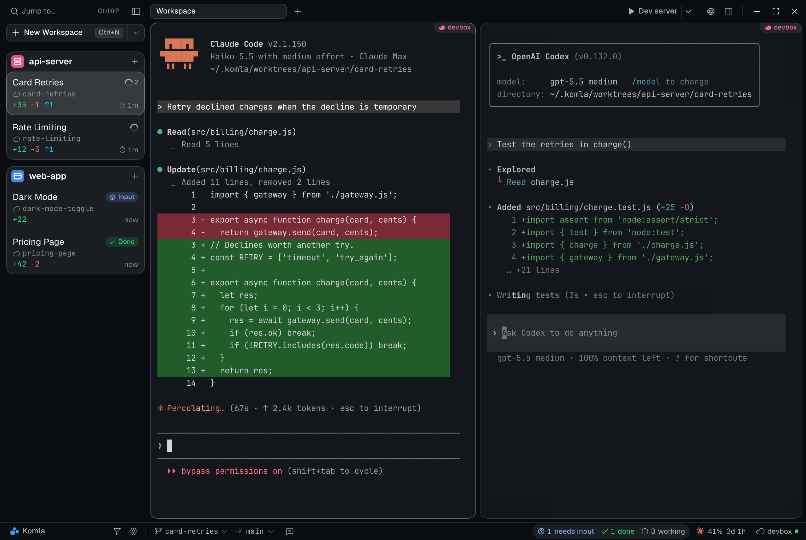
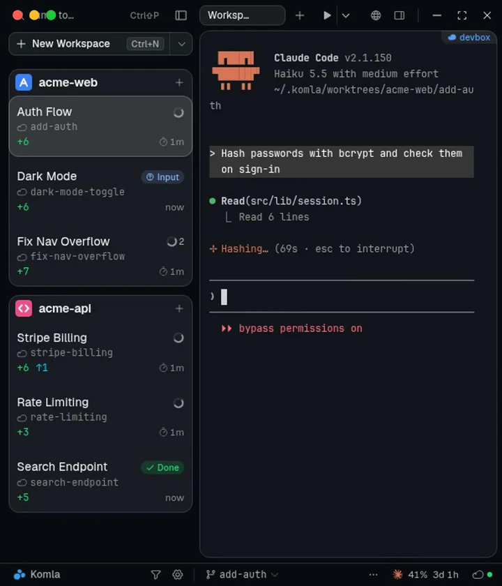
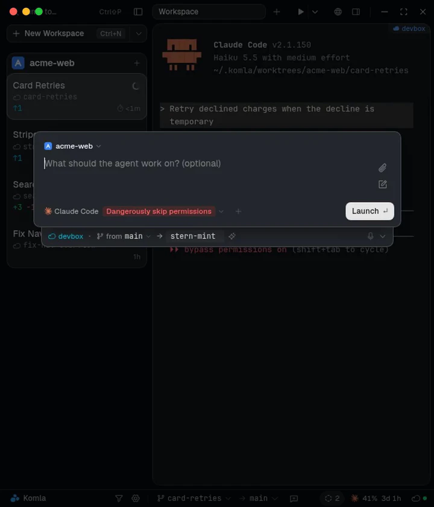
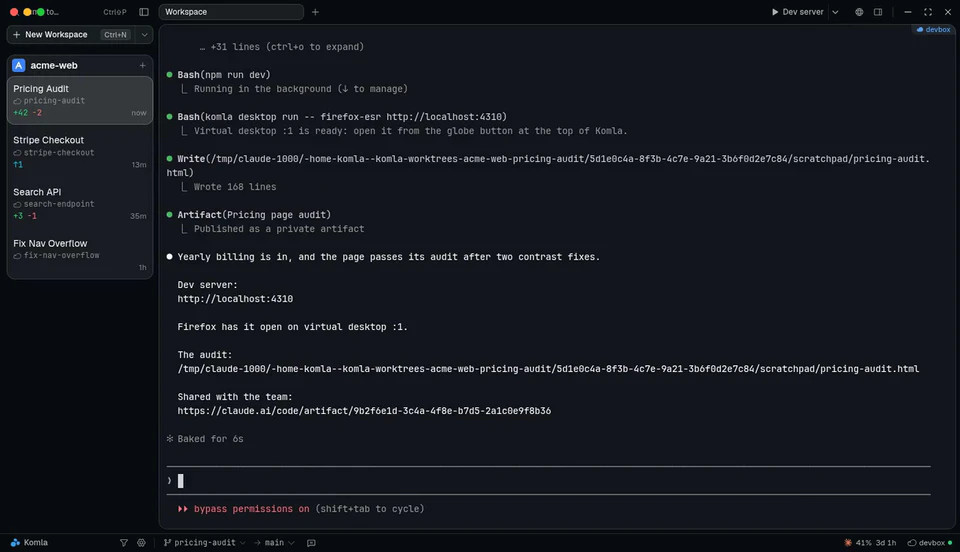
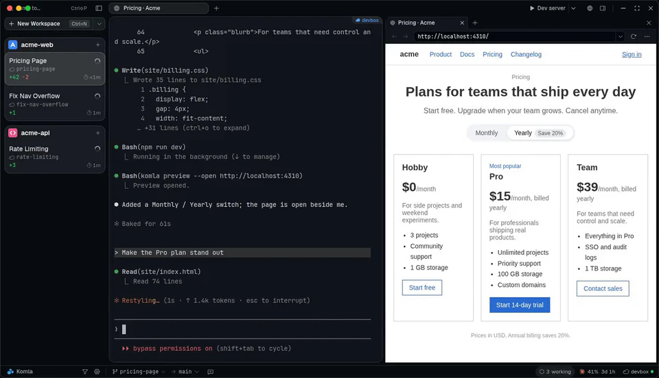

<p align="center">
  <a href="https://komla.dev"></a>
</p>

<h1 align="center">Komla</h1>

<p align="center">
  <strong>Run coding agents in parallel. Stay in control.</strong><br />
  Your attention is the bottleneck, not the agents. Komla shows you which agent needs you next.
</p>

<p align="center">
  <a href="https://komla.dev/download"></a>
</p>

<p align="center">
  
  <a href="LICENSE"></a>
  
</p>

<p align="center">
  <a href="https://komla.dev">Website</a> ·
  <a href="https://komla.dev/download">Download</a> ·
  <a href="docs/FEATURES.md">Features</a> ·
  <a href="docs/CLI.md">Komla CLI</a> ·
  <a href="https://komla.dev/remote-workspaces">Remote SSH</a> ·
  <a href="CHANGELOG.md">Changelog</a>
</p>

<p align="center">
  
</p>

Komla is a desktop app for running AI coding agent CLIs side by side: Claude Code, Codex, OpenCode, Gemini CLI and any other agent that runs in a terminal. Each task gets a workspace with its own git worktree, so agents never step on each other's changes, and every workspace card shows whether its agent is working, done or waiting on you.

It runs the real CLI in a real terminal, on your laptop or on your own servers over SSH. Komla is free and open source, with every feature, no limits and no account.

> "I've tried so many different orchestrators, and I've not resonated with a single one until Komla. I typically sling 10+ terminal sessions across 4-5+ projects — I'm now moving all that to Komla."
>
> — Samuel M., Software Engineering Technical Leader, Cisco

## Work on everything at once. Focus on one thing at a time.

Start a task the moment you think of it, step in only where you're needed, and open what it built in one click.

<table>
<tr>
<td width="50%" valign="top">

### Step in only where you're needed

Every card shows whether its agent is working, done or waiting on you. When one asks a question you get a sound and a notification, so you never poll terminals to find out.



</td>
<td width="50%" valign="top">

### Start a task the moment you think of it

Type or dictate it, pick any agent CLI, and it starts in a workspace of its own, with its own worktree and branch, while you keep working.



</td>
</tr>
</table>

### Open what it built in one click

The globe lists each workspace's dev servers, pages, reports and desktop apps, even on an SSH host. Open one beside the agent or in your browser.

<p align="center">
  
</p>

## Your agents keep working when your laptop sleeps

Run them on any Linux or macOS host over SSH. Diffs, agent status, previews and file upload and download work as if they ran on your laptop, and Komla forwards the ports so a dev server opens in your own browser. Add a VM or container as a host and let agents skip permission prompts, nowhere near your own files. [How remote workspaces work →](https://komla.dev/remote-workspaces)

<p align="center">
  
</p>

## Your agent CLIs, exactly as they ship

Komla runs the real CLI, not a chat wrapper, so every new model, flag and slash command works the day it ships. Mix them however you like: Claude Code in one workspace, Codex in the next.

<p>
  <kbd>Claude Code</kbd> <kbd>Codex CLI</kbd> <kbd>OpenCode</kbd> <kbd>Antigravity CLI</kbd> <kbd>Gemini CLI</kbd> <kbd>Grok Build</kbd> <kbd>Cursor CLI</kbd> <kbd>GitHub Copilot CLI</kbd> <kbd>Hermes Agent</kbd> <kbd>Factory Droid</kbd> <kbd>Amp</kbd> <kbd>Mistral Vibe</kbd> <kbd>Pi</kbd> <kbd>Qwen Code</kbd> <kbd>Goose</kbd> <kbd>Auggie</kbd> <kbd>Devin</kbd> <kbd>Kiro CLI</kbd> <kbd>Kimi Code</kbd> <kbd>Kilo Code</kbd> <kbd>Cline</kbd> <kbd>Crush</kbd> <kbd>+ any terminal agent</kbd>
</p>

Claude Code, Codex CLI, OpenCode and Antigravity CLI get one-click notification setup. Any other agent can set up its own notifications with a self-integration skill, or you can add it as a custom command.

## Also in the box

- **[Komla CLI for agents](docs/CLI.md):** agents create workspaces, start other agents, open previews and add status bar items, with an optional MCP server.
- **Diff viewer:** review an agent's changes split or unified, roll back a block or edit a line in place.
- **Built-in Git GUI:** commit, pull, rebase, push and open pull requests, with commit history, blame and file history.
- **Pull requests and CI:** see each workspace's pull request, CI checks and tags at a glance.
- **Command Center:** <kbd>⌘P</kbd> / <kbd>Ctrl+Shift+P</kbd> searches every workspace, command and shortcut, and finds files by name or content.
- **Automations:** run an agent on a schedule, each run in its own workspace.
- **Remote control (alpha):** check on agents and answer them from your phone over your own Tailscale network, with a push notification when one needs you.
- **Browser preview:** dev servers open beside the agent, even over SSH.
- **Local copy:** sync an SSH workspace to this computer to run desktop and mobile apps locally.
- **Hooks and Quick Commands:** run your own commands when an agent finishes or needs input, and save prompts and commands for any workspace.
- **Plugins, sidebar panels and a custom status bar:** bring your own integrations and live status items.
- **File editor:** Monaco with optional Vim mode, a rich Markdown editor and per-workspace notes.
- **Voice dictation:** dictate prompts offline, in 25 languages.
- **Terminal tabs and splits, multiple windows, custom themes and rebindable shortcuts.**

[docs/FEATURES.md](docs/FEATURES.md) describes everything Komla does.

## Install

**[Download Komla](https://komla.dev/download)** for your platform:

| Platform | Builds | Notes |
| --- | --- | --- |
| macOS | Apple Silicon, Intel | Signed and notarized by Apple |
| Windows (beta) | x64, ARM64 | Zip with an installer inside |
| Linux (beta) | x64, ARM64 | AppImage; needs FUSE (`sudo apt install fuse libfuse2`) |

You need Git and an agent CLI, such as Claude Code or Codex. Add a git repo, describe a task and pick the agent to run it.

Komla downloads new versions in the background and installs them the next time you quit it. On Linux that works when you run the AppImage file itself.

## Questions

<details>
<summary><strong>Why not just run my agents in a few terminal tabs?</strong></summary>

Tabs work for two or three agents. Past that, the hard part is knowing which one is waiting on you, and keeping them out of each other's changes. Komla gives each task its own git worktree and shows on every card which agents need you.

</details>

<details>
<summary><strong>How is Komla different from other agent managers?</strong></summary>

- It runs your real agent CLI in a real terminal, on your laptop or over SSH.
- Any agent that runs in a terminal works, with its own flags and slash commands.
- Your agents can drive Komla themselves through its CLI.
- It's free and open source, with no account.

Side by side: [Conductor](https://komla.dev/guides/conductor-vs-komla), [cmux](https://komla.dev/guides/cmux-vs-komla) and [the Codex app](https://komla.dev/guides/codex-app-vs-komla).

</details>

<details>
<summary><strong>Is my code sent anywhere?</strong></summary>

Your code stays on your machine, and the agents talk to their own APIs, as they would in any terminal. Komla's two AI helpers are optional and send only this:

- **Workspace names:** a new workspace's prompt, to name it. On by default.
- **Commit messages:** your staged diff, only when you click generate.

That text goes through OpenRouter to Google, OpenAI or Mistral, which don't train on it, and Komla doesn't store it. Turn either helper off or use your own key in settings.

</details>

<details>
<summary><strong>Can I use Komla alongside my IDE?</strong></summary>

Yes. Each workspace is a normal folder on disk. Open it in VS Code, Cursor, Windsurf or Xcode with one click, or point any other editor at it.

</details>

<details>
<summary><strong>What happens to worktrees when I'm done?</strong></summary>

Archive a workspace to hide it, or delete it to remove the worktree and branch from disk. They're standard git worktrees, so you can also manage them with git.

</details>

## Build from source

You need Node.js 22 and npm 11, plus the native build tools for `node-pty` and `keyboard-layout`: the Xcode Command Line Tools on macOS, `build-essential`, Python, `libx11-dev` and `libxkbfile-dev` on Linux, or the Visual Studio Build Tools on Windows. On Windows, run the commands from Git Bash.

Rust ([rustup](https://rustup.rs)) is optional. It builds the `komla` CLI and the companion that SSH workspaces use (`npm run dev -- --companion`) and runs their tests, which `npm test` skips without it.

```bash
npm install
npm run dev
```

`npm run dev` keeps its data in `~/.komla-dev`, so it never touches an installed Komla. To package an installer, follow [Manual Platform Builds](docs/RELEASING.md#manual-platform-builds). Packaging bundles the Komla CLI for every platform, and its macOS builds need a Mac.

Builds from source don't update themselves. Komla's AI helpers, which name workspaces and write commit messages, work in them once you choose a custom endpoint under Settings → General → AI utilities.

## Privacy

By default Komla sends an anonymous install ping and a daily heartbeat (app version, OS and agent, no install ID), plus crash reports. Usage analytics tied to a random install ID are opt-in. Settings → General → Privacy changes either. `DO_NOT_TRACK=1` turns all of it off when it's set in the environment Komla starts in, such as a terminal you launch it from; a shell profile doesn't reach an app opened from the Dock or Start menu. [docs/ANALYTICS.md](docs/ANALYTICS.md) lists every event.

## Contributing

Bug reports and pull requests are welcome. Read [CONTRIBUTING.md](CONTRIBUTING.md) before you start. Questions and ideas go to [GitHub issues](https://github.com/tordrt/komla/issues) or straight to the maintainer through [komla.dev/contact](https://komla.dev/contact).

## License

Copyright © 2026 Tafjord Invest AS

Komla is open source under the [MIT License](LICENSE).

The license covers the code, not the Komla name or logo. If you distribute a modified version, give it a different name. [TRADEMARK.md](TRADEMARK.md) has the details.
