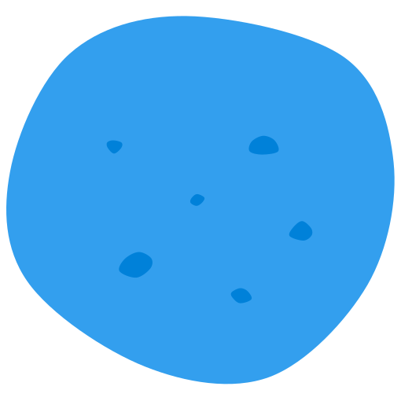

# Komla brand

A komla is a Norwegian potato dumpling: lumpy, round, a bit funny. Komla's mark is three of them, one per agent, because running agents side by side is what the app does. The lumpy outline is what makes the mark ours, so keep it. Smooth circles in a cluster look like a lot of other logos.

## The mark

Three copies of the same komla: a big one in front at the lower left, one at the top and one on the right. Each komla in front is cut out of the ones behind it with a gap around it. The gaps are transparent, not painted in a background color, so the mark works on any background.

The gap has to stay visible, or the three merge into one blob. It's wider at small sizes:

| Where | Size | Gap (share of the mark's width) | Specks |
| --- | --- | --- | --- |
| App icon, `docs/brand/` files | 32 px and up | 4.5% | Yes |
| In-app mark (`KomlaMark`) | 14–20 px | 8% | No, they'd be noise |

Don't draw the mark below 14 px.

## Colors

| | Color | Hex |
| --- | --- | --- |
| Komla blue (Azure) | Body | `#339fee` |
| Specks | Grated specks on the front komla | `#0081d9` |
| Tile | App icon background | `#0f1014` |

Colors are flat: no gradients, glows or shadows.

The app icon is always blue. Inside the app the mark takes the theme's accent (`text-komla`, set from `--komla` in `src/renderer/lib/primary-color.ts`), and falls back to Komla blue when the accent is gray.

## One-color versions

Use `brand/komla-mark-black.svg` or `brand/komla-mark-white.svg` where color isn't available or doesn't fit, such as on a photo or a colored background. They leave out the specks.

 

## Lockup

The mark, then "Komla" in the regular text color in the app's sans-serif (Geist) at semibold. The mark carries the color, so the word stays neutral. The mark's height is about the word's height. Examples:

- The sidebar's top row: a 14–16 px mark at body text size.
- The setup wizard heading, "Welcome to Komla": the lockup sits in a pill tinted with the accent (`bg-komla/15` with a `ring-komla/30` outline).

## The single komla

One komla on its own (`Komla` in code, `brand/komla.svg`) is decoration, not the logo. It's only for the komlas floating behind the setup wizard and the empty main window.

## Don't

- Don't use smooth circles or pebbles instead of the lumpy outline.
- Don't paint the gaps in a background color. Cut them out.
- Don't color the mark anything but Komla blue, black, white or (in the app) the theme accent. Don't add gradients or outline it.
- Don't rearrange, re-rotate or redraw the three komlas.

## Where the files live

| File | What it is |
| --- | --- |
| `resources/icon.svg` | The app icon master: tile plus mark. |
| `scripts/generate-icons.mjs` | Renders `icon.png`, `.icns`, `.ico` and `resources/icons/` from the master, writes the three `docs/brand/komla-mark*.svg` files, and renders the site's favicons when `KOMLA_SITE_PUBLIC_DIR` points at the site's `public/` folder. |
| `src/renderer/components/ui/komla-mark.tsx` | `KomlaMark` (the in-app mark) and `Komla` (the single komla). |
| `docs/brand/` | Standalone SVGs with transparent backgrounds. `komla.svg` is a copy of `Komla`; the rest are generated. |

The three komla outlines live in `icon.svg` (`komla-0`..`komla-2`). To change the shape, edit them there and run `node scripts/generate-icons.mjs`. Then update `KomlaMark`'s copy, which holds the same outlines scaled into a 100-unit box (the square `docs/brand/komla-mark.svg`'s viewBox frames). `tests/renderer/components/ui/komla-mark.test.tsx` fails if either copy falls behind `icon.svg`.
